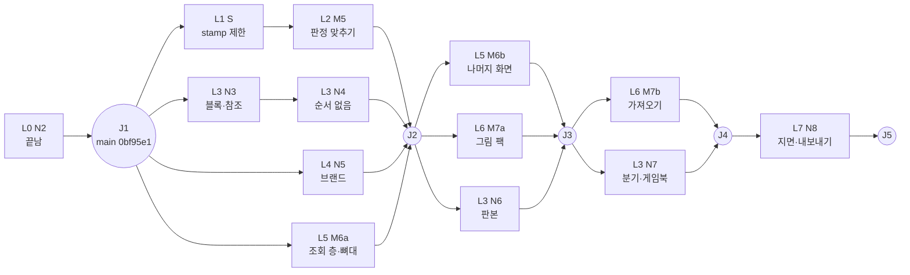

# 남은 마일스톤 병렬 로드맵 (2026-09-28)

남은 마일스톤과 마일스톤 밖 작업을 병렬로 돌릴 수 있는 것과 순서가 필요한 것으로 나눈다. 계획만 적는다. 설계는 다시 열지 않는다.

- 범위와 순서의 근거: `2026-09-27-scope-nonfiction-decision.md`(마일스톤 12개), 정본 아티팩트 §03·§04·§12~§20·§22.
- 레인별 첫 착수 조건과 새 세션 프롬프트: `2026-09-28-roadmap-lanes-early.md`(S·M5·N3·N5·M6), `2026-09-28-roadmap-lanes-late.md`(N4·M7·N6·N7·N8).
- 이 로드맵은 마일스톤의 **범위**를 바꾸지 않는다. 바뀌는 것은 **시작 시점**이다(예: M5를 N3·N4와 동시에). 순서 변경은 사용자 결정 D4다.

## 현재 상태 (2026-09-29 갱신)

- main은 `0bf95e1`(N2 끝)이다. M3·M4·N1·N2 스택을 로컬 fast-forward로 올렸다(D1 B). push는 하지 않았다.
- 옛 브랜치 `feat/locks-levels-m3`, `feat/m4-occurrences`, `feat/n1-knowledge-pack`, `feat/n2-sources`는 모두 main 안에 들어 있다. 지울지는 사용자에게 묻는다.
- 지금 체크아웃은 `feat/n3-blocks`(`0bf95e1`)다. 다른 세션이 여기서 N3 계획을 쓴다.
- **원격이 없다**(`git remote -v`가 비어 있다). `.github/workflows/ci.yml`은 있지만 한 번도 돌지 않았다.
- 끝난 것: M0~M4, N1, N2. `npm run check` 715/715. N2 완료 기준 `test/acceptance/n2.test.js` 7/7.
- MCP 도구는 11개다(`folio_sources` 포함). 내장 팩은 `novel`, `knowledge`, `sources` 셋이다.
- S(`stamp` 제한)는 아직 없다.
  - S는 `run-checks.js`만 바꾸고 N2·N3와 겹치는 파일이 없다. 그래서 J1 뒤에 들어가도 된다.
  - N3의 새 검사기는 지적에 `severity`를 적지 않는다. 그래서 N3는 S 없이 시작해도 된다.
  - M5 실행 전에는 S가 병합돼 있어야 한다.

## 절대 규칙 (모든 레인·프롬프트에 그대로)

- 잠금 규칙은 설정, 팩, 세트, 기능 토글 어느 것으로도 끌 수 없다.
  - hash 일치
  - 영수증
  - hard 차단
  - 추가만 되는 기록장
  - 자기검토 표기
  - soft 비자동수정
  - `core.promise-order`는 항상 돈다
- 엔진은 모델을 부르지 않는다. `core/`와 `packs/`는 모델이나 네트워크를 부르지 않는다.
- 검사 세트는 작가가 고른다. 새 검사는 `experimental`로 시작하고 기본 등급은 advisory다.
- 새 기능은 `work.yaml` `features`로 켜고 끌 수 있어야 한다.
- 테스트는 합성 fixture만 쓴다. 원본 fixture는 고치지 않는다.
- 파일이 300줄을 넘으면 나눈다.
- `/path/to/vibelore`는 읽기 전용이다.
- 병합, push, PR, 정본 수정 전에는 반드시 사용자에게 묻는다.

## 마일스톤 범위와 건드릴 모듈 (추정)

| # | 한 줄 범위 (정본·범위 결정) | 주로 건드릴 곳 |
|---|---|---|
| N2 | 근거 연결 기록장, 추출 `claims`, `packs/sources`, `folio_sources`, `sourcebook` (§13·§16) | `core/evidence/*`, `core/sources/*`, `features.js`, `generate.js`, `commit-step.js`, `runner.js`, `payload.js`, `scope.js`, `check.js`, `yaml-schema.js`, `init.js`, `packs/index.js`, `definitions.js`·`handlers.js`, `SKILL.md` |
| N3 | 블록 번호, 각주, 참고문헌, 색인, 상호 참조 유효성 검사 (§04 블록 id, §20 이후 표) | `core/store/blocks.js`, `store/work.js`, `index/{rebuild,schema,query}.js`, `status.js`, `server/tools/find.js`, 새 결정론 검사(코어 또는 `packs/knowledge`), 참고문헌은 `core/sources/*`·evidence 읽기 |
| N4 | `order: none`의 검사: 앞뒤 검사는 해당 없음, 상호 참조 중심 검사, 노드 연결 표 읽기 (§04, §10 끝) | `config.js`(order), `store/position.js`, `ledger/events.js`, `scope/scope.js`, `checks/run-checks.js`, `checks/builtin.js`, `pack/yaml-schema.js`(`requiresOrder`), `index/query.js`, `run/next.js`, `store/tree.js`(links), `server/tools/find.js` |
| M5 | vibelore 검사기 이식, 사건 기록 전환, 약속 사건·검사, 소설 세트 3개, 판정 비교 테스트 (§14, §20 M5) | `packs/novel/**`(pack.yaml, checkers, checks, prompts), `core/promise.js`(휴면 판정), 사건 종류, 판정 비교 fixture, `test/pack/*` |
| M6 | 뷰어: 읽기, 엔티티, 관계도, 떡밥 보드, 세트·단계 토글, 영수증, 비문학 화면, 정적 내보내기 (§17) | 새 `viewer/**`, 새 읽기 전용 조회 층(`core/view/*` 제안), `server/tools/handlers.js`(`folio_view`), 단계 토글 → `work.yaml` 쓰기 경로, `package.json`(→ D6) |
| M7 | 그림 팩(설명서 → 생성 전 점검 → 생성 → 검토), 엔티티 기준 그림 참조, `folio_import_vibelore` (§14·§18) | `packs/image/**`, `core/store/assets.js`, 그림 단계용 실행 경로(→ 설계 필요), `definitions.js`·`handlers.js`(도구 추가), 가져오기 모듈(새 `core/import/*`) |
| N5 | 브랜드 세트: 어조, 금지 표현, 수치 대조 (§03 회사 문서) | 새 팩 또는 세트(`packs/brand/**` 제안), `packs/index.js`, 수치 대조는 N2 `numbers-match`·evidence 재사용 |
| N6 | 판본: 본문마다 판본 키, 검사·영수증은 판본별, 원본 대비 누락·추가 검사 (§04) | `config.js`(`SUPPORTED_VARIANTS`), `ledger/{receipts,recheck}.js`, `runner.js`(`newRun`의 `variant: 'main'`), `recheck-plan.js`, `recommit-plan.js`, `receipt-builder.js`, `commit.js`, `recheck-step.js`, `index/rebuild.js`, `store/tree.js`(판본 본문 저장), `scope/stale.js` |
| N7 | `order: branching`, 게임북 팩: 경로별 검사, 막다른 분기, 도달 불가 장면 (§03·§04) | N4가 건드린 순서 파일 전부, `store/tree.js` links, 새 `packs/gamebook/**`, `scope/scope.js`(연결된 노드의 사건) |
| N8 | 지면(페이지·펼침면 배치)과 내보내기(PDF·EPUB·웹) (§03, §20 이후) | 새 `core/layout/*`, 새 `core/export/*`, 도구 추가 또는 `folio_view` 확장, 블록 번호(N3)·판본(N6)·그림(M7)·뷰어 정적 내보내기(M6) 읽기 |

## 공통으로 바뀌는 곳 (핫스팟)

| 파일 | 누가 바꾸나 | 규칙 |
|---|---|---|
| `server/tools/definitions.js`, `handlers.js` | N2, M7, N8(도구), N3·N4(`folio_find` query) | 도구는 `TOOLS` **끝에만 추가**한다. 이미 있는 항목의 순서와 문구는 그 도구를 만든 레인만 고친다 |
| `test/server/tools.test.js`, `occurrence-tools.test.js:12-13` | 도구를 더하는 레인 | 이름 목록과 수는 도구를 더하는 커밋에서 함께 늘린다. BANNED 가드 목록은 **늘기만** 한다 |
| `core/work/features.js` | N2, N3, M6, M7, N6, N7, N8 | `FEATURES`·`FEATURE_PARENTS`·`RUN_FEATURES`에 **끝에만 추가**한다. 기존 기본값은 바꾸지 않는다. `test/core/features.test.js`와 `feature-toggles.test.js`도 같은 커밋에서 고친다 |
| `packs/index.js`, 팩 목록 테스트 | N2, N5, M7, N7 | 끝에만 추가한다 |
| `skill/folio/SKILL.md` | 모든 레인 | 레인마다 `references/<주제>.md`를 새로 만든다. SKILL.md에는 링크와 도구 한 줄씩만 끝에 추가한다 |
| `core/run/runner.js` (N2 뒤 약 210줄) | N2, N6, M7 | 한 번에 한 레인만 소유한다. 250줄을 넘길 레인은 첫 태스크에서 먼저 나눈다 |
| `core/scope/scope.js`, `core/run/payload.js` | N2, N4, N6, N7 | 코어 레인(N3→N4→N6→N7)이 순서대로 소유한다. 다른 레인은 건드리지 않는다 |
| `core/index/{rebuild,schema,query}.js`, `core/store/tree.js` | N3, N4, N6, N7 | 코어 레인만 소유한다 |
| `core/checks/run-checks.js` | S, M5, N4 | S가 먼저 병합된다. 그 뒤 M5와 N4는 `stamp`를 건드리지 않는다 |
| `core/pack/yaml-schema.js` | N2, M5, N4, N7 | 필드는 추가만 한다. 기존 필드의 뜻은 바꾸지 않는다 |
| `test/fixtures/**` | 전부 | 원본은 고치지 않는다. 새 fixture는 레인 이름이 붙은 새 폴더에 만든다(예: `test/fixtures/parity-serial/`) |
| `package.json` | M6(→ D6) | 루트 `dependencies`는 `yaml`, `@modelcontextprotocol/sdk` 둘뿐이고 늘리지 않는다 |

## 의존 표

| 대상 | 기능 의존 | 파일 충돌 상대 | 위험 | 이유 |
|---|---|---|---|---|
| S (`stamp` 제한) | 없음 | M5, N4 (`run-checks.js`) | 낮음 | 한 줄 규칙과 테스트. N2·N3는 `run-checks.js`를 건드리지 않는다 |
| N3 | N2 (참고문헌이 자료·근거를 읽음) | N2(`packs/knowledge`, `definitions.js`), N4(`index/*`, `find.js`) | 중간 | 블록·색인 조회가 N4 링크 조회와 같은 파일에 들어간다 |
| N4 | N3 (none의 중심 검사가 상호 참조 유효성) | N3, N6, N7(순서·범위 파일), S(`run-checks.js`) | 높음 | `position`, `events`, `scope`, `builtin`은 잠금 검사 `core.promise-order`와 맞닿아 있다 |
| M5 | S (소설 `dead-on-stage`가 지적마다 severity를 적음) | S, N5(`packs/index.js`만) | 낮음 | 대부분 `packs/novel/**` 안에서 끝난다. 약속 휴면 판정을 넣으면 `core/promise.js`를 건드린다 |
| M6 | 화면별: 읽기·엔티티·영수증 = M4까지, 근거 = N2, 블록 = N3, 떡밥 보드 = M5 | M7(`handlers.js`), 모든 레인(조회 대상 모양) | 중간 | 조회 층을 새 파일로만 두면 충돌은 작다. 대신 데이터 모양이 바뀔 때마다 뒤따라 고쳐야 한다 |
| M7a 그림 팩 | M3 실행기, 그림 단계용 실행 경로 설계 | N6(`runner.js`), `packs/index.js` | 중간~높음 | 그림을 노드 단계로 돌릴지, 따로 돌릴지에 따라 코어 실행기를 건드린다 |
| M7b 가져오기 | M5 (소설 검사와 사건 종류), M6 (완료 기준이 뷰어에서 열림) | `definitions.js` | 낮음 | 새 모듈과 도구 하나 |
| N5 | N2 (`numbers-match`, evidence. 주장은 작품에 `sources` 팩이 있을 때만 요청됨), S | M5(`packs/index.js`) | 낮음 | 팩 하나. 코어는 건드리지 않는 것이 목표다 |
| N6 | N3·N4 병합 뒤가 안전 | 코어 거의 전부(영수증, 재검사, 실행기, 색인) | 높음 | 판본 키가 영수증과 hash 잠금 경로를 모두 지난다. 다른 코어 레인과 동시에 돌리지 않는다 |
| N7 | N4 (순서 방식 뼈대, 링크 읽기), N6 (판본별 영수증 모양이 확정된 뒤) | N4, N6 | 높음 | 같은 순서·범위 파일을 다시 연다 |
| N8 | N3 (번호), N6 (판본), M6 (정적 내보내기), M7 (그림) | 새 모듈 위주, `definitions.js` | 중간 | 읽기만 하는 쪽이 많다. 형식별 도구 선택은 D9 |

## 레인

| 레인 | 담는 것 | 동시에 도는 상대 | 합류 |
|---|---|---|---|
| L0 N2 | N2 (끝남, main `0bf95e1`) | — | J1 (끝남) |
| L1 S | (a) `stamp` 제한 | N3, M5 계획 | J1 뒤 따로. M5 실행 전 |
| L2 소설 | M5 | N3 → N4 | J2 |
| L3 코어 | N3 → N4 → N6 → N7 (직렬, 코어 핫스팟 소유) | M5, N5, M6, M7 | 마일스톤마다 |
| L4 팩 | N5 | N3, M6 | J2 |
| L5 뷰어 | M6a 조회 층과 뼈대 → M6b 나머지 화면 | N3·N4, M7a | M6a는 J2, M6b는 J3 |
| L6 그림 | M7a 그림 팩(설계 먼저) → M7b 가져오기 | N6 | J3·J4 |
| L7 지면 | N8 | 없음(마지막) | J5 |

동시에 구현하는 레인은 **셋까지**만 둔다. 리뷰어를 가장 강한 모델에 맡기는 태스크가 많고, 머신 부하가 오르면 전체 테스트가 몇 분씩 걸린다(N2 계획 기록).

합류 지점(J)에서는 한 레인씩 main에 병합한다. 병합할 때마다 `npm run check`를 돌리고, 사용자 확인을 받는다.

- J1: N2 (끝남). S는 J1 뒤 따로 병합한다(M5 실행 전)
- J2: S(아직이면) → M5 → N3 → N4 → N5 → M6a
- J3: M6b → M7a → N6
- J4: M7b → N7
- J5: N8

## 전제 조건 — 병렬 전에 정할 것 (사용자에게 묻기만 한다)

정해진 것(2026-09-29 사용자): D1 B, D8 A, D4 승인, D5 A, D6 A, D10 A. 모든 레인은 main에서 딴다.

아직 정하지 않은 결정과 그 결정이 막는 것:

| 결정 | 막는 것 |
|---|---|
| D2 | J2부터 |
| D3 | 막지 않음 |
| D7 | 막지 않음. 따로 묻는다 |
| D9 | N8 |

| # | 결정 | 선택지 | 추천 |
|---|---|---|---|
| D1 | main을 어디까지 올릴까 | A. N1 끝 `69608e5`까지 로컬 fast-forward (M3·M4·N1은 최종 리뷰가 "병합 가능" 판정). B. N2가 끝난 뒤 N2 끝까지 한 번에. C. 계속 쌓기 | **정해짐: B**. N2 끝 `0bf95e1`까지 fast-forward했다. 모든 레인이 main 하나에서 출발한다 |
| D2 | 레인 결과를 main에 넣는 방식 | A. `merge --no-ff` (합류 커밋 하나). B. rebase 뒤 fast-forward. C. 원격 PR | **A**. 마일스톤 하나를 `git revert -m 1` 한 번으로 되돌릴 수 있다. D1의 기존 스택은 ff로 올린다 |
| D3 | 원격과 push | A. 원격 없이 로컬만 쓴다. B. 비공개 원격을 만들고 main만 push해서 CI를 돌린다. C. B에 더해 레인마다 PR을 연다 | **B**. `ci.yml`이 한 번도 돌지 않았고, Node 22·24·26 매트릭스를 확인할 길이 없다. PR은 M8(범위 밖) 전에는 부담만 크다 |
| D4 | 순서 변경 승인 | 범위 결정 표의 순서(N3 → N4 → M5 → M6 → …)를 위 레인 그림대로 겹쳐 돌려도 되는가 | 승인. 범위는 그대로다. M5와 N5는 코어 핫스팟을 거의 건드리지 않는다 |
| D5 | (a) `stamp` 규칙 | A. 지적 `severity`는 advisory·block만 허용하고, 검사 선언 등급보다 높일 수 없다(낮추기만). hard는 `pack.yaml`에서만 온다. B. 지적 `severity`를 무시하고 선언 등급만 쓴다 | **A**. 소설 `dead-on-stage`(hard 선언, 지적마다 block)를 그대로 살리면서, 외부 팩이 hard를 만들 수 없게 한다. 잠금에 맞닿은 변경이므로 가장 강한 리뷰어에 맡긴다 |
| D6 | 뷰어 의존성 | A. `viewer/`에 따로 `package.json`을 둔다(Vite·React·React Flow·elkjs는 거기 devDependencies). 루트는 빌드 결과만 `node:http`로 보여 준다. B. 루트 devDependencies에 넣는다. C. 의존성 없는 순수 HTML·JS | **A**. 루트 런타임 의존성 두 개 규칙이 그대로다. 빌드 결과를 커밋할지는 M6 계획에서 정한다(추천: 커밋하지 않고 M8에서 패키징) |
| D7 | 정본 §20·§22 #7 갱신 (b) | A. D1~D4를 정한 직후 한 번에 고친다. B. 모든 N 마일스톤이 끝난 뒤 | **A**. 범위 결정 기록이 정본보다 앞서는 상태가 길어질수록 새 세션이 헷갈린다. 고칠 문안은 먼저 보여 주고 승인을 받는다 |
| D8 | 로드맵 문서의 자리 | A. main에 커밋한다. B. 레인 브랜치에 커밋한다 | **정해짐: A**. 레인 worktree가 main에서 이 문서를 읽는다. N3 체크아웃을 건드리지 않도록 임시 worktree에서 커밋했다 |
| D9 | N8 내보내기 형식 | 런타임 의존성을 늘리지 않고 EPUB은 `node:zlib`으로 직접 zip을 쓰고, 웹은 정적 HTML로 낸다. PDF는 A. 호스트나 사용자 도구(브라우저 인쇄)에 맡긴다. B. 의존성 규칙에 예외를 둔다 | **A**. N8 계획을 쓸 때 다시 확인한다 |
| D10 | M5 판정 비교 방법 | A. 레인 안의 스크립트가 vibelore를 읽기 전용으로 돌려 합성 fixture의 기대 판정 JSON을 만들고, 그 JSON만 커밋한다. B. 테스트가 vibelore 경로를 직접 import한다 | **A**. 저장소 테스트가 외부 경로에 묶이지 않는다. 쇼케이스 3화 나란히 비교는 커밋하지 않는 수동 확인으로 남긴다 |

## 미룬 minor (d) — 소유 레인에 붙인다

| 출처 | 항목 | 붙일 레인 |
|---|---|---|
| N1 | 코어 `stamp`가 지적 severity를 따름 | S |
| N1 | 결정론 인용 한계, O(n·m) avoid 성능, ABA 겹침, NUL avoid, `ctx.work` 없음, knowledge digest 전용 테스트 | N3 (knowledge 검사를 여는 레인). 최종 리뷰가 "둬도 됨"으로 분류했으므로 싼 것만 고친다. N3 계획서에 넣는다 |
| N1 | `scope.js`가 모든 팩의 `prerequisites`를 읽음 | N4 (범위 파일 소유) |
| M4 | 같은 이름 엔티티 후보 누락, dedupe 조용히 버림, `baseHash` 안 읽힘, `isPlainObject`·file-tx 경로 중복 | N6 (코어 정리 시점). 중복 제거는 줄 수가 줄 때만 한다 |
| M3 | 로드 때는 받고 resolve 때 거부되는 파이프라인 모양, `validatePack` 오류 경로 표시, 느슨한 프리셋 스키마 | M5 (`pack.yaml` 스키마가 바뀔 수 있는 레인) |
| M3 | `INTERNAL_ERROR`에 Node 원문, 사용자 입력을 자르지 않고 되풀이함 | M6a (서버 응답을 새로 쓰는 레인) |
| N2 | `sources.numbers-match` NFKC 오탐(㎡·² → 2, ① → 1), 날짜 한 덩어리, 1.50 ≠ 1.5 | N5 (이 검사를 재사용) |
| N2 | 제3자 팩에서 프리셋은 있고 파이프라인은 없을 때 `packPresets`에 들어감(`init.js`·`yaml-schema.js`) | M5 (`pack.yaml` 스키마 레인) |
| N2 | `sources/` lstat과 쓰기 사이 TOCTOU, 같은 FS hard link, 팩 digest가 도우미 파일(`claims.js`)을 반영하지 않음, `add` 경로의 중간 링크 | 코어 레인(N3 또는 N4의 정리 태스크) |
| N2 | 근거 기록장이 깨지면 `evidence`가 켜진 동안 모든 실행이 `LEDGER_TAMPERED`(M4 잠금 규칙과 같음), `getSource`는 통째 실패 | N6 (기록장 경로를 여는 레인). 잠금 규칙은 약화하지 않는다 |
| N2 | `isPlainObject` 세 벌, record-run·status 뼈대 중복 | N6 (M4 중복 정리와 함께) |

## 위험과 되돌리기

| 위험 | 신호 | 되돌리기 |
|---|---|---|
| 끝에만 추가하는 목록이 병합 때 부딪힌다 | `definitions.js`, `features.js`, 목록 테스트 충돌 | 먼저 병합된 쪽 순서를 그대로 두고, 늦게 온 레인 항목을 끝에 붙인다. 목록 테스트를 같은 커밋에서 고친다 |
| 레인이 잠금 경로를 건드려 우회가 생긴다 | 리뷰어 공격 스크립트가 통과한다 | 잠금 인접 태스크는 가장 강한 리뷰어에 맡긴다. `test/acceptance/*`의 잠금 테스트는 약화하지 않는다 |
| 한 마일스톤 병합이 main을 깨뜨린다 | 합류 뒤 `npm run check` 실패 | `--no-ff` 합류 커밋을 `git revert -m 1 <merge>`로 되돌린다. 레인 브랜치는 남긴다 |
| M6 조회 층이 뒤 마일스톤 데이터 모양에 끌려다닌다 | M6b 화면이 자주 깨진다 | 조회 층은 `core/view/*` 한 곳에만 둔다. 데이터를 내는 레인이 조회 층 테스트를 같이 고친다 |
| N6 판본이 영수증 형식을 바꾼다 | 기존 영수증 읽기 실패 | 판본 키가 없는 영수증은 `main`으로 읽는다(현재 `?? 'main'` 동작 유지). 기록장은 추가만 한다 |
| worktree가 쌓여 헷갈린다 | `git worktree list`가 길어진다 | 레인이 끝나면 superpowers:finishing-a-development-branch로 정리한다. 삭제는 사용자 확인 뒤 |
