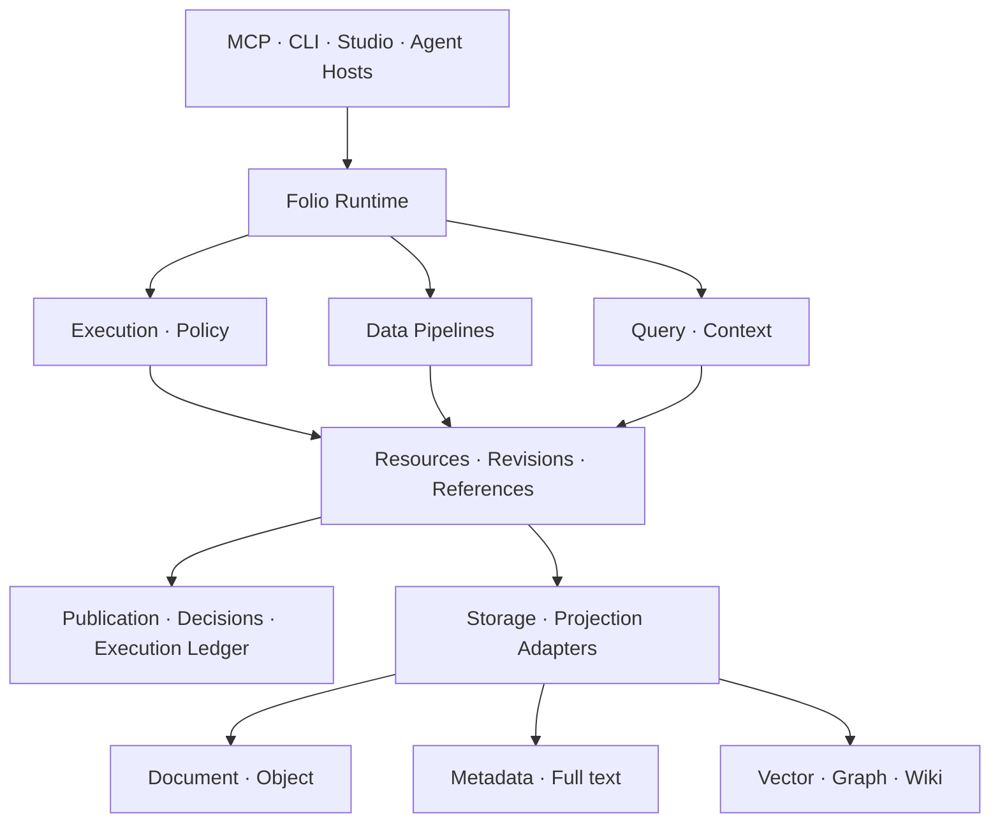

# Folio 아키텍처 v2 설계 초안

> 착수 시점의 조사·설계 기록이다. 이후 실제 구현과 검증은 [실행 기록](execution-report.md)을 확인한다.
작성일: 2026-10-08. 사용자 인계서와 [코드 현황](current-state-audit.md),
[독립 리뷰](harsh-review.md), [수용 판정](review-rebuttal.md)을 반영한 설계 초안이다.
범용 계약은 신규 제안이며 현재 구현 완료를 뜻하지 않는다.
기존 착수 계획서와 구현한 강제 잠금을 유지한다.

## 1 제품 방향과 확정 범위

Folio는 AI가 사용·생성·변환하는 원본과 결과, 검색·지식 뷰, 실행·결정 이력을 관리한다.
창작은 현재 구현된 첫 사례이고 제품의 범위는 일반 작업까지 확장한다.
Vibelore는 소셜 창작자용 독립 제품이며 필요한 입력·자산 계약만 재사용한다.
Folio가 분야별 상세 하네스를 모두 제공해야 데이터 관리를 할 수 있는 구조로 만들지 않는다.

| 인계서의 결정 | 적용 |
|---|---|
| 범용 Core + Domain Packs | 도메인 중립 envelope와 선택한 분야 payload·검사를 분리 |
| Balanced 기본·Strict 선택·Autonomous 장기 | 모드가 위임·승인·예산에 영향, 강제 잠금은 유지 |
| Hybrid 원본 | 직접 소유·외부 참조·관측 snapshot 상태를 구분 |
| Pack + Custom + AI Dynamic | 지원 계약 안의 선언형 구성과 후보 재계획 |
| DAG + Agentic | 현행 호환 → 정적 DAG → 복구/재시도 → 동적 재계획 |
| 복합 검색 | 질문과 지원 기능에 맞춰 일부 계층만 선택 |
| Eventual Consistency + Revision-aware | 파생 계층의 지연 허용, 판본·발행 가시성은 명시 |
| MCP 우선 | 같은 Control Plane에 CLI/API/Studio를 후속 연결 |
| LLM Wiki와 Context Assembly | 근거·판본·범위를 가진 파생 지식 뷰 |

실제 DB/인덱스 제품, 물리 서비스 분할, 성능 목표, 보존 정책과 전체 트랜잭션 경계는 미확정이다.
아래 발행 경계와 Query 계약은 이번 리뷰의 권고안이다. Wiki Hybrid 갱신도 추천안이며 확정 결정으로 쓰지 않는다.

## 2 논리 구조와 책임

같은 프로세스와 SQLite+파일로 시작할 수 있다. 논리 계층 수가 DB나 서비스 수를 정하지 않는다.
공통 Adapter framework는 실제 두 구현의 차이가 생길 때 만든다.

| Folio Control Plane의 책임 | Adapter 또는 호스트의 책임 |
|---|---|
| 자원 ID·판본·내용 무결성·참조 상태 | bytes 저장과 읽기·외부 참조 관측 |
| 입력 선택·계보·발행 완료·결정 결속 | 형식 파싱·변환·렌더링 |
| 실행 상태·멱등성·정책·필요한 승인 | 실제 모델·도구 호출·임베딩 |
| Projection manifest·최신성·Query 범위 | 인덱싱·검색·그래프 탐색 |
| 관측 수준·누락·검토와 품질 상태 | 실제로 측정하거나 보고한 trace/usage |

현재 `core/`에는 로컬 I/O도 있다. 이를 이름만 바꿔 한꺼번에 밖으로 옮기지 않는다.
모델·네트워크는 계속 core 밖이다. Folio 직접 실행 목표도 외부 execution Adapter를 통해 실현한다.
Adapter가 외부 동작을 한다고 승인·무결성·발행 결정을 대신 소유하지 않는다.

## 3 도메인 중립 계약

공통 envelope는 식별·판본·저장·참조·상태를 검증한다.
Resource 내용은 문서·JSON·이미지 등이고 `schemaRef`와 분야 의미는 선택사항이다.
Core에 Character/Chapter/Quest/Fact/Event 테이블이나 값 타입을 강제하지 않는다.
기존 집필 Entity/Event/Observation은 집필 Adapter·Pack의 계약으로 계속 읽는다.

| 계약 후보 | 필수 구분 |
|---|---|
| Resource | resourceId, kind 또는 namespace, content format, 소유/참조 모드 |
| Revision | revisionId, resourceId, parentRevisionIds, content hash, schemaRef, 보관 상태 |
| Reference | 정확한 대상 판본 또는 명시적 미확인 외부 참조, 관계 namespace |
| Operation | 요청한 작업·정책·입력 선택·요청자·idempotency key |
| Execution | 실제 시도·출력·실패·재시도·관측 범위; Operation과 별도 |
| Projection | 입력 manifest, 생성기/설정 판본, 결과 generation, 확인 범위 |
| Policy | 허용 action/scope, 승인·예산·만료·철회와 모드 |
| Knowledge View | 선택 범위의 주장·판본·근거와 사용자 보기 |
| Context Package | 실제 선택한 자원/Projection 판본·근거·누락·길이 예산 |

Observation은 해석 기록의 후보다. 이를 모든 도메인의 확정 사실 표로 만들지 않는다.
추출한 주장·추론은 독립 JSON Resource 또는 분야 Projection으로 표현할 수 있다.
값의 의미와 시간·관점·독자 공개 범위는 Pack이 정의한다.
Core는 선택한 범위와 정의 판본을 보존하고, 소설 전용 시간 해석기를 필수로 넣지 않는다.

## 4 권위 있는 원본과 파생 정보

원본은 사용자가 해당 작업의 기준으로 선택한 정확한 판본이다.
자료 등록 후보와 현재 핵심 원본 선택은 구분하며 선택 marker가 그 판본을 결정한다.
직접 보관한 bytes, 외부에서 실제 관측한 snapshot, 사람이 확정한 정의·설정은 각각 출처를 가진다.
출처의 권위·사용자 채택·원문 인용 일치·AI 추론·세계의 사실 여부는 별도 상태다.
원문에 적혀 있고 사용자가 가져왔다고 해서 내용의 진실을 인증하지 않는다.

생성·추출·정규화 결과는 원본과 별도 Resource/Projection이다.
한 원본에서 여러 해석과 표현을 만들 수 있다. 결과를 핵심 원본으로 선택하면 새 결정으로 기록한다.
표현 프로필은 언어·스타일·형식·용도만 소유하고 원본 값을 조용히 바꾸지 않는다.
Reference 계보는 실제 사용 기록이다. Vector 유사도나 AI 추정 관계를 실제 실행 계보로 올리지 않는다.

## 5 Hybrid 원본과 입력 보존

| 상태 | 가능한 주장 |
|---|---|
| owned_snapshot | 보관된 bytes와 hash를 검증하고 특정 과거 판본 읽기 |
| external_unobserved | URI/외부 ID만 알고 현재 bytes·변경 여부는 unknown |
| external_observed | connector가 시각·판본·hash를 실제 관측. 지금까지 불변이라는 보장은 아님 |
| external_snapshotted | 관측한 bytes를 보관해 그 판본 검증 가능 |
| unavailable/changed | 관측 실패·접근 불가 또는 새 판본. 마지막 확인과 구분 |

제공자의 reportedHash/reportedRevision은 Folio가 실제 읽은 hash와 다른 필드다.
외부 참조를 확인하지 못하면 current로 추정하지 않는다. 외부 원본 변경을 감지하려면
허가된 connector 관측이 필요하며 core가 네트워크를 호출하지 않는다.
일반 Reference 등록과 결과 품질 채택은 별도 동작이다. 현행 이미지 URI 승인 차단은 유지한다.

실행 입력은 정확한 판본과 선택 범위·정의·프로필·검사·파이프라인 판본을 고정한다.
재현에 필요한 bytes를 보관하지 못한 입력은 reference-only/missing으로 명시한다.
입력 고정 이후 원본 HEAD 변경이 과거 실행의 입력을 바꾸지 않는다.
입력 보존은 비결정적 모델의 동일 결과 재생성을 보장하지 않는다.

## 6 발행과 트랜잭션 권고 경계

강하게 결속할 것은 결정·입력·결과 판본·필수 검사와 최종 Publication이다.
파생 색인·Wiki 갱신은 이후 완료될 수 있다. 발행 완료와 부가 관측 완전성은 별도다.
첫 범용 구현은 한 로컬 작업 공간·단일 기록자로 제한한다.

1. 후보의 불변 객체·입력 사본·결과 bytes를 먼저 검증·보관한다.
2. 실제 결정/유효한 위임과 검사 영수증을 후보 digest 및 기대 publication head에 묶는다.
3. 발행 준비 intent에 대상의 before/after hash와 필요한 기록 참조를 보존한다.
4. 모든 필수 참조를 검증한 뒤 최종 publication marker를 추가한다.
5. 활성 선택·현재 Query는 marker로 정하고 Projection 갱신을 예약한다.

여러 파일에 동시에 쓰는 원자성을 주장하지 않는다. 객체가 존재해도 marker 없이는 미발행이다.
첫 범용 구현은 source-selection/result-publication/grant-issued/grant-revoked를 같은
추가만 되는 workspace-state 기록장에 순서화한다. workspaceCheckpoint는 그 seq/hash다.
InputSnapshot은 선택 판본과 source-selection marker, 준비 당시 checkpoint를 함께 결속한다.
Query는 checkpoint 이하의 선택·발행 상태를 fold한다. 원본 선택 A→B도 checkpoint를 바꾼다.
다른 trace/검사 기록장은 marker가 가리키는 불변 manifest에 결속하며 강제적인 다기록장 원자성을 주장하지 않는다.
HEAD는 marker에서 재구성 가능한 선택 상태로 두고 결정의 유일한 증거로 쓰지 않는다.
복구는 before 상태 또는 이미 쓴 after 상태만 진행한다. 다른 편집은 충돌로 멈춘다.
충돌한 실행은 이유를 기록해 비파괴적으로 skip하고 새 실행으로 넘어갈 수 있어야 한다.
신규 편집을 읽어 새 before baseline으로 삼아 이전 승인을 소급 적용하지 않는다.

현행 commit는 별도 경로로 유지하며 H1–H6부터 보완한다.
이미 receipt와 연결된 event/retraction은 legacy 모드에서도 final commit 전에는 숨긴다.
기존의 미연결 seed는 옛 집필 Adapter에서 legacy 의미로 읽는다. 신규 범용 Query에
확정 원본으로 옮기려면 dry run·분류·사용자 선택 manifest가 필요하다. 옛 데이터의 읽기를 즉시 막지 않는다.
rename 원자 교체가 곧 정전 durability인 것은 아니다. fsync·운영체제별 내구성은 별도 수용 조건이다.

## 7 Projection과 Query 최신성

ProjectionManifest 후보 필드는 `projectionId`, `kind`, `generationId`, `inputManifestId`,
`workspaceCheckpoint`, `generatorRevision`, `definitionRevision`, `parametersHash`,
`status`, `coverage`, `outputHashes`, `builtAt`이다.
미완성 generation은 current로 공개하지 않는다. 기존 generation을 먼저 지우지 않는다.

Query 요청은 `selector: current | atRevision | atCheckpoint`, `freshness: requireCurrent | allowStale`,
필요한 계층·분야 scope를 지정한다. 응답은 요청 selector, 실제 해석 판본·checkpoint,
계층별 generation/입력, `current/stale/partial/unknown`, 근거·누락·충돌을 포함한다.
current는 답할 때 확보한 checkpoint와 관측 범위에 대해 정의하며 영구 최신성을 뜻하지 않는다.

| 상황 | 응답 규약 |
|---|---|
| SQL=A, Vector=B, Graph=A | 같은 최신 결과로 숨겨 결합하지 않음. 지정 A만 선택하거나 mismatch/partial |
| requireCurrent에 오래된 계층 | 미충족 상태와 원인. 최신 근거를 확보한 계층만 사용하도록 명시적으로 축소 가능 |
| allowStale | 사용한 옛 판본·입력·오래됨 이유를 반환 |
| 외부 원본 미관측 | 최신성 unknown, 마지막 관측과 구분 |
| bytes/hash 불일치 | integrity failure로 멈춤. stale 허용으로 손상을 통과시키지 않음 |
| 후보/prepared | 현재 확정 조회에서 제외. 별도 요청 시 상태를 표시 |

부분 범위는 coverage로 표현하며 모든 계층의 응답을 단일 성공 bool로 축약하지 않는다.
Projection 최신성과 결과물의 원본 변경 재검토는 별도 상태다.
최신 metadata가 옛 원본 A로 만든 결과를 표시할 수 있으며, 이때 Projection은 current이고
결과에는 source-selection 변경에 따른 reviewRequired 사유가 붙을 수 있다.
페이지 cursor는 selector·checkpoint·정렬·filter digest에 결속한다.
옛 generation이 없어지면 새 결과의 offset으로 계속하지 않고 cursor expired를 반환한다.
검색은 필요한 Metadata/Full-text/Vector/Graph 일부만 수행하고 정확한 원본 위치로 이어진다.
벡터 profile·차원·metric·입력 판본이 다르면 같은 공간처럼 비교하지 않는다.

## 8 실행 관측과 정책

ExecutionPlan은 pipelineRevision과 정적 DAG를 가진다. 실제 시도는 별도 trace다.
재계획은 새 planRevision·부모 trace·이유를 만들고 기존 입력과 기록을 덮어쓰지 않는다.
각 시도는 requestId, inputManifest, output hashes, status, error, attempt/parent를 가진다.

관측 수준은 `folio-executed`, `host-reported`, `reference-only`로 구분한다.
필드별 reported/observed/unavailable과 누락 목록을 남긴다.
provider/model/prompt/parameters/context/tool/usage/cost/latency가 없으면 unknown이며 0으로 채우지 않는다.
모델의 비공개 추론은 수집 대상으로 가정하지 않는다.

Strict는 명시적인 결정 지점을 늘리고 Balanced는 위임받은 일반 작업과 중요한 Watch/충돌을 나눈다.
Autonomous는 정책 범위에서 자동 진행·재계획할 수 있지만 fixed 변경·hard 우회 권한을 얻지 않는다.
위임은 actor/action/resource scope/definition/policy revision/expiry/revocation에 결속한다.
결정·입력 문서의 명령문은 위임을 발급하지 않는다.
고정 policyRevision은 당시 조건이며 현재 허가를 대신하지 않는다. marker 직전 같은 work lock 안에서
workspace-state의 grantId를 resolve하고 철회·만료·현재 policy 선택을 다시 검사한다.
늦은 응답·미발행 복구도 같은 검사를 거친다. Query의 과거 checkpoint가 현재 접근 권한을 우회하지 않는다.
이미 발행한 결정의 복구는 과거 결정을 재구성하는 것이며 철회 뒤 새 채택으로 취급하지 않는다.

Folio가 직접 통제하는 실행만 횟수·예약 예산·토큰·비용 상한을 집행했다고 주장한다.
외부 독립 실행의 보고 비용은 기록할 수 있지만 지출을 차단했다는 보장은 없다.
처음에는 신뢰하는 로컬 단일 사용자로 제한한다. 원격 API/공유 전에는 인증·ACL이 필요하다.

## 9 LLM Wiki와 Context Assembly

자동 생성 Wiki는 근거·입력 판본·생성기·검토·범위를 가진 Projection이다.
사람이 작성하거나 확정해 보호 대상으로 삼은 Wiki는 독립 Resource다.
AI 갱신은 새 후보로만 제시하고 사람 Resource의 현재 판본을 자동 교체하지 않는다.

Living/Temporal/Multi-perspective/Provenance/Agent Memory는 선택한 분야별 뷰다.
임시 agent memory는 검증된 지식과 구분한다. Context Resolver는 필요한 범위의 정보만
선택하고 각 조각의 판본·근거·누락·길이 예산을 Context Package로 보존한다.
Wiki 전체를 항상 입력하거나 Wiki 문장을 자동 확정 사실로 사용하지 않는다.

갱신은 on-demand, background, hybrid를 비교한다. Hybrid는 변경 기록→비동기 갱신→조회 시 확인의
후보 정책이며 이번에 확정하지 않는다. stale Wiki를 requireCurrent Context에 조용히 포함하지 않는다.

## 10 보안과 보존의 미확정 경계

비밀 키를 로그 필드로 받지 않으며 마스킹된 표시와 보관된 원문을 구분한다.
민감 payload는 필요한 접근 권한을 가진 별도 내용 객체에 두는 방향을 검토한다.
마스킹된 내용 hash를 원본 bytes hash처럼 표시하지 않는다.

삭제는 원본·결과·Projection·trace payload·백업·외부 참조별로 범위를 정해야 한다.
append-only marker에 tombstone을 더하는 것만으로 내용과 백업의 삭제가 끝나지는 않는다.
기존 기록장에 포함된 인용·사용자 피드백은 아직 삭제 정책이 없다.
이 긴장을 해결하지 않은 상태로 개인정보 삭제·보존 정책이 구현됐다고 주장하지 않는다.

## 11 확장과 기존 기능 보존

먼저 현행 결함을 고치고, 원본 등록→입력 고정→호스트 결과 제출→검토/발행→판본 조회의
작은 수직 슬라이스를 만든다. 텍스트·JSON과 이미지 참조, 기존 집필 회귀로 범용성을 시험한다.
일반 변형 결과를 위해 main 지원 목록이나 draft/events 잠금을 풀지 않는다.

기존 작품은 강제 이행 없이 사용한다. 신규 자원 연결은 과거 bytes가 없는 상태까지 명시한
반입 manifest로 만들고 기존 commit 영수증을 위조하지 않는다.
검색·Wiki·정적 DAG·Agentic·Studio·Export는 별도 단계로 수용한다.
[implementation-plan](implementation-plan.md)은 첫 구현과 후속 실험의 완료 조건을 분리한다.
